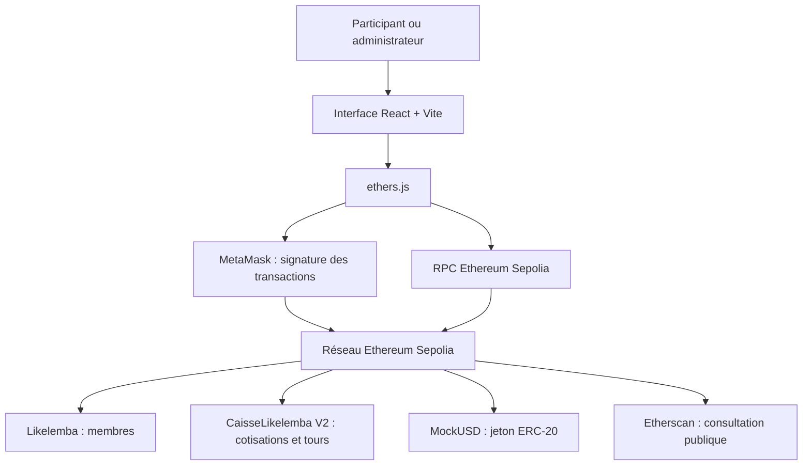

# Likelemba V2 — Plateforme de tontine décentralisée

**Épargne solidaire 3.0 | React · Solidity · ethers.js · MetaMask · Ethereum Sepolia**

> **Projet académique — Université de Kinshasa (UNIKIN)**  
> Faculté des Sciences et Technologies · Mention Mathématiques, Statistiques et Informatique  
> Master 1 · Cours de Blockchain et cryptomonnaies · Groupe 07 · Année académique 2025–2026

## 1. Présentation du projet

**Likelemba V2** est un prototype d'application décentralisée (**DApp**) destiné à la gestion d'une tontine, appelée *likelemba* en République démocratique du Congo. Dans une tontine rotative, des membres contribuent à une caisse commune ; à chaque tour, un bénéficiaire reçoit la cagnotte conformément aux règles convenues.

Le projet transpose ce mécanisme dans un environnement blockchain : les règles essentielles sont exprimées dans des **contrats intelligents Solidity**, tandis qu'une interface **React** permet aux participants et à l'administrateur de consulter les informations et de soumettre des transactions via **MetaMask**.

La réalisation repose sur **Ethereum Sepolia**, un réseau public de test. Les jetons **mUSD** sont fictifs et n'ont pas de valeur monétaire garantie. **Likelemba V2 est un prototype pédagogique, pas un service financier opérationnel.**

### Problématique

La gestion traditionnelle d'une tontine peut rencontrer des difficultés de suivi des contributions, de vérification des versements, de transparence sur les bénéficiaires et de conservation d'un historique commun. Comment utiliser les contrats intelligents pour formaliser les règles d'une épargne rotative, faciliter la consultation de son état et enregistrer les opérations sur un réseau blockchain public ?

### Objectifs

- Numériser la gestion d'un groupe de tontine et de ses participants.
- Définir des règles de cotisation et de rotation exécutables par contrat intelligent.
- Connecter les portefeuilles Ethereum à une interface web accessible sur ordinateur et mobile.
- Utiliser un jeton de test ERC-20 pour les versements et les distributions.
- Rendre les informations et transactions consultables sur un explorateur public.
- Mettre en pratique les contrôles d'accès, la validation des opérations et la traçabilité blockchain.

## 2. Équipe du projet

**Groupe 07 — Université de Kinshasa**

- **NAKALENGI MBUDA Dieu a vu**
- **MALEBA DIYAZOLA Sang précieux**

**Sujet :** *Tontine décentralisée (Likelemba) : épargne rotative sur contrats intelligents.*

## 3. Technologies utilisées

| Composant | Technologie | Rôle dans Likelemba V2 |
| --- | --- | --- |
| Interface | React 18, Vite 6, CSS | Pages, interactions et affichage responsive |
| Bibliothèque blockchain | ethers.js 6 | Lecture des contrats, signatures et transactions |
| Portefeuille | MetaMask | Connexion à un compte et validation des transactions |
| Contrats intelligents | Solidity | Règles métier de la tontine exécutées sur blockchain |
| Bibliothèque de contrats | OpenZeppelin | Composants ERC-20 et utilitaires utilisés dans les contrats du projet |
| Jeton de démonstration | MockUSD (mUSD), ERC-20 | Cotisations et cagnotte en unités de test |
| Réseau blockchain | Ethereum Sepolia — `chainId: 11155111` | Exécution publique des tests |
| Développement des contrats | Remix IDE | Compilation, déploiement et interactions avec les contrats |
| Hébergement du code | GitHub | Versionnement et partage du code source |
| Hébergement web envisagé | Vercel | Publication de l'interface React |

### Quelques définitions utiles

- **Blockchain :** registre partagé dans lequel les transactions confirmées sont regroupées en blocs et rendues consultables par les participants du réseau.
- **Tontine / likelemba :** système d'épargne collective à contributions régulières et attribution successive d'une cagnotte.
- **DApp :** application dont certaines règles ou données essentielles sont prises en charge par des contrats sur une blockchain.
- **Smart contract (contrat intelligent) :** programme déployé sur une blockchain, qui exécute des fonctions suivant des règles codées.
- **ERC-20 :** standard d'interface couramment utilisé pour les jetons fongibles sur Ethereum.
- **MetaMask :** portefeuille permettant de gérer des comptes Ethereum et de signer des transactions.
- **ABI :** description des fonctions et événements d'un contrat, nécessaire pour communiquer avec lui depuis JavaScript.
- **RPC :** interface de communication utilisée pour interroger un nœud blockchain.
- **Gas :** unité de mesure du travail informatique effectué par le réseau ; les transactions peuvent demander des frais en SepoliaETH.
- **Sepolia :** réseau Ethereum de test, distinct du réseau principal et réservé ici aux expérimentations.

## 4. Fonctionnalités intégrées dans le code

### Espace de consultation

- **Tableau de bord :** état des contrats, compte connecté, solde mUSD et informations de la tontine.
- **Membres :** nombre de participants, liste des adresses et statut du portefeuille connecté.
- **Cotisations :** montant prévu, informations du jeton et lancement du versement.
- **Tours et bénéficiaires :** tour en cours, bénéficiaire prévu, cotisations reçues et restantes, selon les fonctions disponibles dans la caisse.
- **Transactions :** accès aux opérations visibles sur Etherscan.
- **Contrats et réseau :** adresses, présence du code sur Sepolia et accès à l'explorateur.

### Actions blockchain prévues par l'interface V2

Le code de l'application contient des fonctions pour :

1. Connecter MetaMask et contrôler le réseau Sepolia.
2. Ajouter un participant, avec vérification du rôle administrateur et des conditions d'inscription.
3. Supprimer un participant lorsque les règles de la caisse le permettent.
4. Fermer les inscriptions pour ouvrir la phase de cotisation.
5. Vérifier le statut du participant, le solde et l'éventuelle cotisation déjà effectuée pour le tour.
6. Autoriser le contrat de caisse à utiliser les mUSD nécessaires, via **`approve`**, puis appeler **`cotiser`**.
7. Vérifier le nombre de cotisations attendues et appeler **`distribuer`** lorsque toutes les conditions sont remplies.

**Précision :** la présence d'une fonction dans le code ne constitue pas, à elle seule, une preuve de validation de tous les scénarios sur Sepolia. Les opérations sensibles dépendent également des contrats réellement déployés, de leur état et des confirmations MetaMask.

## 5. Architecture du système



Le **frontend** se charge de la présentation et des interactions. Les **transactions d'écriture** demandent une signature du portefeuille ; les **fonctions de lecture** permettent de consulter certaines données publiques sans dépenser de jetons. La validation définitive des règles métier revient au contrat intelligent, et non à l'interface React.

### Responsabilités des contrats

| Contrat | Responsabilité principale |
| --- | --- |
| **MockUSD** | Fournir le jeton de test mUSD utilisé pour les opérations de la tontine. |
| **Likelemba** | Conserver les informations relatives aux membres dans la version historique du projet. |
| **CaisseLikelemba V2** | Gérer les participants, les cotisations, l'état des tours et les distributions de la cagnotte. |

## 6. Règles de gestion de Likelemba V2

Les règles présentées ci-dessous sont celles visées par l'interface V2 et les fonctions qu'elle appelle :

- **Inscription :** l'administrateur autorisé peut gérer les participants avant la fermeture des inscriptions.
- **Effectif :** le code prévoit une tontine d'au moins **2** participants et une limite maximale déclarée de **20** participants.
- **Cotisation :** le montant configuré pour un versement est de **10 mUSD** par participant et par tour, soit `10 × 10^18` unités minimales pour un jeton à 18 décimales.
- **Ouverture :** la fermeture des inscriptions marque le passage à la phase de cotisation dans cette version.
- **Unicité :** un participant ne doit pas cotiser deux fois au même tour.
- **Distribution :** l'administrateur déclenche la distribution lorsque toutes les cotisations requises sont reçues ; la caisse détermine le bénéficiaire selon sa logique interne.
- **Traçabilité :** les transactions confirmées sont associées à un identifiant (`transaction hash`) consultable sur Sepolia.

**Exemple pédagogique :** pour 2 membres contribuant chacun à hauteur de 10 mUSD, la cagnotte théorique d'un tour est de **20 mUSD**, hors frais de réseau payés en SepoliaETH. Cet exemple illustre la règle de calcul ; il ne certifie pas qu'une distribution particulière a déjà eu lieu.

## 7. Contrats configurés sur Ethereum Sepolia

Les valeurs ci-dessous correspondent à la configuration **actuellement publiée dans `src/config.js`** du dépôt GitHub.

| Contrat | Adresse configurée |
| --- | --- |
| **MockUSD (mUSD)** | `0xB668C95fDa0fDaDa874dBE82f814F5E4a534fB50` |
| **Likelemba** | `0x4610Fa7518636236b3d7A420EaA98D5b3cC45F20` |
| **CaisseLikelemba V2** | `0x14A7Cd98e92aCA05C4B12171067dDe7aaA64f21F` |

**Explorateur :** https://sepolia.etherscan.io/

**Important sur les versions :** l'adresse `0x374652A2D439948D41bcA89948722184DECe94B2` figurait dans une configuration **antérieure** de la caisse et ne correspond pas à l'adresse de caisse V2 indiquée dans le `src/config.js` actuellement publié. Ne pas mélanger ces deux adresses. Avant la démonstration, vérifier sur Etherscan et dans MetaMask que les contrats utilisés correspondent bien au réseau et aux fonctions attendus.

## 8. Organisation du dépôt

```text
Tontine-decentralisee-likelemba-/
├── src/
│   ├── App.jsx          # Pages et interactions de l'application
│   ├── chain.js         # Connexion blockchain, ABI et opérations
│   ├── config.js        # Réseau, RPC et adresses des contrats
│   ├── main.jsx         # Point d'entrée React
│   └── styles.css       # Mise en forme responsive
├── .env.example         # Exemple de configuration publique
├── .gitignore           # Exclusions Git
├── index.html           # Point d'entrée HTML
├── package.json         # Scripts et dépendances
├── package-lock.json    # Versions résolues des dépendances
├── vite.config.js       # Configuration Vite
└── README.md            # Documentation du projet
```

Le dépôt GitHub présenté ici contient principalement **l'interface web**. Les fichiers Solidity complets et une éventuelle suite de tests automatisés doivent être ajoutés séparément au dépôt s'ils sont requis pour la remise académique ; leur présence n'est pas attestée par cette arborescence.

## 9. Installation et exécution en local

### Prérequis

- Node.js et npm installés.
- Git (ou téléchargement ZIP du dépôt).
- Un navigateur moderne avec l'extension MetaMask.
- Un portefeuille configuré sur **Ethereum Sepolia**.
- Du SepoliaETH de test uniquement pour les transactions nécessitant du gas.

### Récupérer le code

```bash
git clone https://github.com/Sang-precieux/Tontine-decentralisee-likelemba-.git
cd Tontine-decentralisee-likelemba-
```

### Installer les dépendances et démarrer l'interface

Sous **Windows PowerShell** :

```powershell
npm.cmd install
npm.cmd run dev
```

Ouvrir ensuite l'adresse affichée par Vite, généralement **http://localhost:5173/**.

Sous un terminal où `npm` est directement disponible, utiliser `npm install` et `npm run dev`.

Pour arrêter le serveur de développement : **Ctrl + C** dans le terminal.

### Construire la version de production

```powershell
npm.cmd run build
npm.cmd run preview
```

Le dossier **`dist/`** contient les fichiers générés et ne doit pas être versionné dans Git.

## 10. Configuration des variables d'environnement

Vite permet de définir des adresses et une URL RPC avec des variables préfixées par **`VITE_`**. Un fichier `.env` peut être créé à la racine du projet en utilisant les adresses correspondant aux contrats effectivement déployés.

```dotenv
VITE_MOCKUSD_ADDRESS=0xB668C95fDa0fDaDa874dBE82f814F5E4a534fB50
VITE_LIKELEMBA_ADDRESS=0x4610Fa7518636236b3d7A420EaA98D5b3cC45F20
VITE_CAISSE_ADDRESS=0x14A7Cd98e92aCA05C4B12171067dDe7aaA64f21F
VITE_SEPOLIA_RPC=https://ethereum-sepolia-rpc.publicnode.com
```

**Vérification nécessaire :** la version initialement publiée de `.env.example` contient encore des valeurs héritées d'une ancienne configuration, notamment une adresse de caisse différente et une adresse MockUSD incomplète. **Mettre `.env.example` à jour** avec les valeurs vérifiées de V2 avant de le copier dans `.env` ou de renseigner Vercel.

Les variables **`VITE_`** sont intégrées au code destiné au navigateur : **elles ne doivent jamais contenir une clé privée, une phrase de récupération ou un véritable secret**. Le fichier `.env` reste exclu du suivi Git.

## 11. Parcours utilisateur

### Participant

1. Ouvrir l'application et connecter MetaMask sur Sepolia.
2. Vérifier son inscription et consulter son solde en mUSD.
3. Lorsque les inscriptions sont closes et que le tour accepte les cotisations, sélectionner **Cotiser**.
4. Si nécessaire, autoriser la caisse à dépenser le montant requis avec `approve`.
5. Examiner puis confirmer la transaction `cotiser` dans MetaMask.
6. Attendre sa confirmation et consulter le hash de transaction sur Etherscan.

### Administrateur

1. Connecter le portefeuille disposant du rôle administrateur.
2. Inscrire ou retirer des participants, dans les limites prévues par la caisse.
3. Fermer les inscriptions lorsque le groupe est constitué.
4. Suivre les contributions et les informations de chaque tour.
5. Lorsque toutes les cotisations requises sont reçues, lancer **Distribuer la cagnotte** et vérifier le résultat sur Sepolia.

La capacité d'exécuter une action dépend des droits réels du compte, de l'état du contrat et de la disponibilité du réseau.

## 12. Sécurité et bonnes pratiques

- **Contrôle d'accès :** distinguer les opérations réservées à l'administrateur de celles accessibles aux participants ; la règle doit être appliquée par le contrat.
- **Validation des opérations :** vérifier les adresses, l'état de la tontine, les montants, les autorisations et la non-duplication des cotisations.
- **Gestion des approbations ERC-20 :** préférer une autorisation limitée au montant utile et contrôler précisément l'adresse du contrat autorisé.
- **Signature locale :** les opérations sensibles sont soumises à MetaMask ; ne jamais transmettre la phrase secrète ou la clé privée.
- **Traçabilité :** utiliser les identifiants de transaction et les événements du contrat pour les vérifications.
- **Fiabilité du réseau :** prévoir les erreurs RPC, les transactions refusées et les périodes d'indisponibilité.
- **Tests avant usage réel :** des essais automatisés, une revue du code Solidity et une analyse de sécurité restent nécessaires avant d'envisager toute utilisation financière hors testnet.

**Avertissement :** le frontend ne doit pas être considéré comme une garantie de sécurité du contrat. La vérification complète suppose l'examen du code effectivement déployé et, idéalement, de son code source vérifié sur l'explorateur.

## 13. Vérification et état de la réalisation

Le dépôt contient du code pour les fonctions de lecture et d'écriture mentionnées plus haut. Au cours du développement, une procédure `approve → cotiser` a été exécutée dans l'environnement de test ; cette observation ne remplace pas une campagne complète de tests reproductibles sur l'adresse finale de la caisse V2.

Pour une remise académique vérifiable, conserver idéalement :

- Les sources exactes de **MockUSD**, **Likelemba** et **CaisseLikelemba V2**, ainsi que les ABI correspondant aux contrats déployés.
- Les adresses et transactions de déploiement sur Sepolia.
- Les scénarios d'essai documentés : gestion des membres, autorisations, cotisations, refus de doubles versements, tours et distribution.
- Les captures d'écran pertinentes et les liens d'exploration des transactions.
- Les résultats de tests automatisés et d'une analyse de sécurité, lorsqu'ils sont disponibles.

**À distinguer :** l'intégration de **Chainlink VRF** ou **Chainlink Automation**, les pénalités automatiques et les paiements en argent réel ne sont **pas attestés** dans le code de ce dépôt et ne doivent pas être présentés comme fonctionnalités réalisées.

## 14. Déploiement de l'interface sur Vercel

1. Vérifier le dernier commit sur la branche `main` et mettre à jour `.env.example`.
2. Dans Vercel, créer un nouveau projet et importer le dépôt GitHub : **`Sang-precieux/Tontine-decentralisee-likelemba-`**.
3. Choisir **Vite** comme framework.
4. Configurer le **Root Directory** sur la racine du dépôt (`./`), le **Build Command** sur `npm run build` et l'**Output Directory** sur `dist`.
5. Configurer si nécessaire les variables publiques `VITE_...` avec les adresses **V2** correctes.
6. Déployer, puis tester la navigation, la connexion MetaMask, la lecture RPC et la correspondance des contrats sur Sepolia.

**Lien de la DApp publique :** à ajouter une fois le déploiement Vercel effectué.

Le déploiement Vercel publie **le frontend** ; il ne redéploie pas les contrats Solidity déjà présents sur Sepolia.

## 15. Limites et perspectives

Likelemba V2 est une réalisation académique sur un **réseau de test**. Les portefeuilles Ethereum ne correspondent pas nécessairement à des identités civiles vérifiées ; les transactions publiques peuvent exposer des liens entre adresses ; les frais de gas et la disponibilité du réseau influencent les opérations. L'administration du groupe et la distribution reposent sur les autorisations prévues par le contrat.

Les améliorations envisageables comprennent l'automatisation sécurisée des échéances, des notifications, des tests d'invariants, un audit de sécurité, une meilleure indexation des événements et des parcours de récupération en cas d'erreur. Tout passage à des fonds réels demanderait des validations techniques, juridiques et financières supplémentaires.

## 16. Références

- [Ethereum — Documentation officielle](https://ethereum.org/fr/developers/docs/)
- [Solidity — Documentation officielle](https://docs.soliditylang.org/)
- [OpenZeppelin Contracts](https://docs.openzeppelin.com/contracts/)
- [ethers.js — Documentation](https://docs.ethers.org/v6/)
- [React — Documentation](https://react.dev/)
- [Vite — Documentation](https://vite.dev/)
- [MetaMask — Documentation développeur](https://docs.metamask.io/)
- [Sepolia Etherscan](https://sepolia.etherscan.io/)

---

**Projet académique — Groupe 07, Université de Kinshasa · 2025–2026**  
**Code source :** https://github.com/Sang-precieux/Tontine-decentralisee-likelemba-  
**Usage :** enseignement, expérimentation et démonstration sur Ethereum Sepolia.  
**Licence :** aucune licence de réutilisation n'est déclarée dans le dépôt à la date de rédaction ; une éventuelle licence devra être ajoutée explicitement par les auteurs.
